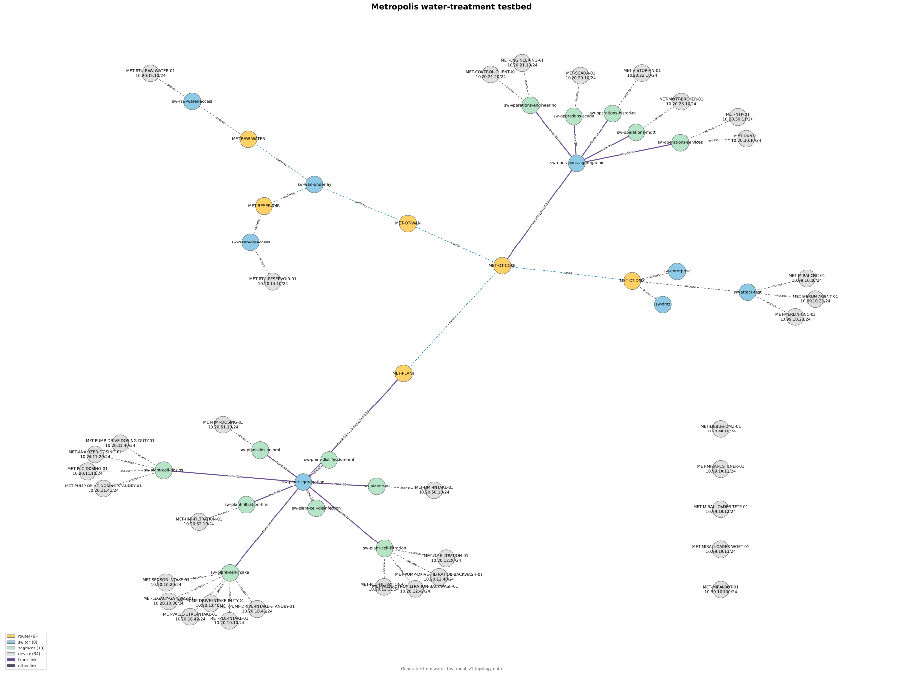

# Metropolis

**OT/ICS detection systems and synthetic testbeds**

[](https://github.com/kbrezinski/metropolis/actions/workflows/ci.yml)
[](LICENSE)
[](https://www.python.org/downloads/)
[](testbeds/metropolis/devices/)
[](https://www.gns3.com)

Research on OT/ICS network traffic and provenance-based detection. A testbed is
a self-contained simulated network you can run, attack, and capture.
The current focus is the testbed and its tooling; detection models and training
are early-stage work.

[Metropolis](testbeds/metropolis/) is the first testbed: a GNS3 water-treatment
plant, inspired by the reusable-device, router/switch, scenario, and
data-generation ideas of the [Gotham IoT Testbed](https://github.com/xsaga/gotham-iot-testbed)
and laid out along Purdue zones.

Each testbed owns its topology, IP assignments, node names, device deployments,
and attack targets. Shared schemas define reusable document formats; they do not
force testbeds to use the same CIDRs. Gotham scripts may be reused where their
assumptions fit.

The reference implementation is the [Gotham repository](https://github.com/xsaga/gotham-iot-testbed),
described in [“Gotham Testbed: A Reproducible IoT Testbed for Security Experiments and Dataset Generation”](https://doi.org/10.1109/TDSC.2023.3247166).
If you build on Gotham's work, follow its license and cite the paper as
appropriate.

## Start here

| I want to… | Guide |
|---|---|
| Build and run the GNS3 testbed | [GNS3 setup and experiments](scripts/gns3/README.md) |
| Use the Python library | [Python package](#python-package) |
| Run an attack scenario | [Attack toolkit](scripts/attacks/README.md) |
| Extract or clean PCAP features | [Processing scripts](scripts/README.md#dataset-processing-pipeline) |
| Change devices or protocol settings | [Device reference](testbeds/metropolis/devices/README.md) |
| Find topology settings and run files | [Dataset guide](testbeds/metropolis/datasets/water_treatment_v1/README.md) |
| Review declared network security | [Codex Security review](scripts/security/README.md) |
| Connect the external REA tool | [REA guide](docs/rea.md) |

The sections below explain the design and workflow. The linked guides contain
the complete commands and settings for each tool. Python installation alone
does not build images or create a GNS3 project.

## What you can do today

- **Build the device images**, register their GNS3 templates, and create the
  declared topology with repeatable commands rather than adding nodes by hand.
- **Generate attack traffic** against those nodes with the experiment toolkit,
  which selects targets from the inventory by default and accepts explicit
  overrides.
- **Validate the design** — the address plan, inventory, link plan, router
  interfaces, OSPF networks, and switch VLANs are checked against each other by
  one command.
- **Review declared network security on demand** — a separate Codex Security
  tool records evidence-backed findings and theoretical attack paths. Runs
  require Daybreak Blue access. See the
  [security review guide](scripts/security/README.md).
- **Capture traffic** on chosen links, and record it under the versioned dataset
  folder. A combined experiment command records PCAPs, logs, CPU/RAM samples,
  and a run manifest, then generates per-link traffic reports and charts.
  See the [metrics guide](scripts/gns3/README.md#cpu-memory-and-traffic-reports).
- **Select optional device and link profiles** to constrain CPU, RAM, bandwidth,
  delay, jitter, and loss for a run, with saved baselines and cleanup. See the
  [profile guide](scripts/gns3/README.md#optional-device-and-link-profiles).
- **Extract and conservatively clean packet features** from completed PCAP runs
  with the two Metropolis processing scripts.
- **Design a topology in Python** — build a network, check it for contradictions,
  draw it, and write it out as the same dataset documents everything else reads.
  Start with `scripts/build_a_topology.py` or
  `uv run python -m metropolis.topology --help`.

## What is in the repository

- **Testbed definitions** — `testbeds/` holds one folder per environment:
  Metropolis router scripts, switch and VLAN specifications, device models, and
  its versioned dataset.
- **Reusable schemas** — `schemas/` defines shared formats for topology,
  firewall policy, experiment runs, and normalized device logs.
  Each testbed stores its own concrete allocations, nodes, and cabling, and the
  topology validator checks the declared topology documents against their
  schemas. The firewall renderer validates the policy separately.
- **Emulated devices** — Dockerfiles and Python apps under
  `testbeds/metropolis/devices/`: Modbus TCP PLC/RTU models, MQTT telemetry, a
  broker, SCADA, HMI, historian, and an engineering workstation. There is also
  an attack-lab set of synthetic C2 and botnet nodes.
- **Normal-operation traffic** — a routine Modbus client, local DNS and NTP, and
  a legacy Telnet host, so captures contain more than attacks.
- **Experiment toolkit** — `scripts/attacks/` generates attack traffic. Start
  with [its README](scripts/attacks/README.md).
- **Research package** — `src/metropolis/` provides topology and early-stage
  model scaffolding. PCAP extraction and cleaning are scripts under `scripts/`;
  labelling and model training remain future work.
- **Gotham data pipeline** — `scripts/run_gotham_pipeline.py` cleans and labels
  the separately downloaded Gotham dataset. It does not build or run Metropolis.

## Network design

The diagram below is generated from the versioned Metropolis topology data.
Select it to view the full-size SVG. Isolated nodes are declared in the dataset
but have no link in the current plan; this diagram does not verify live GNS3
cabling.

[](docs/images/metropolis-topology.svg)

Regenerate it after changing the topology:

```bash
uv run python -m metropolis.topology --dataset testbeds/metropolis/datasets/water_treatment_v1 draw --out docs/images/metropolis-topology.svg --title "Metropolis water-treatment testbed" --note "Generated from water_treatment_v1 topology data"
```

The plan uses separate sites and routed zones, following Purdue concepts as a
guide:

| Purdue-style area | Metropolis role | Declared networks |
|---|---|---|
| Levels 0-1 | Sensors, actuators, PLCs, and RTUs in process cells | `10.20.10.0/24` – `10.20.15.0/24` |
| Level 2 | HMIs and local control access | `10.20.50.0/24` – `10.20.53.0/24` |
| Level 3 | SCADA, engineering, historian, MQTT, and OT services | `10.20.20.0/24` – `10.20.23.0/24`, `10.20.30.0/24` |
| Level 3.5 | OT DMZ | `10.20.40.0/24` |
| Level 4 | Simulated enterprise network | `10.30.10.0/24` |
| Lab-only test zone | Attack-generation hosts | `10.99.10.0/24` |
| Inter-site transport | Simulated WAN underlay, with reserved IPsec overlays | `172.31.255.0/24`; `10.20.254.12/30` and `10.20.254.16/30` reserved |

These ranges belong to Metropolis. Future testbeds can use the same schema with
different CIDRs, or reuse an allocation pattern deliberately when two
environments need to be comparable.

The reference topology declares 70 GNS3 nodes across four plant cells—intake,
dosing, filtration, and disinfection—and two remote RTU sites. It covers a
treatment plant, a raw-water lift station, and a
reservoir/booster station, with routers and switches organised by backbone and
location. See the [router scripts](testbeds/metropolis/router/), [switch
specifications](testbeds/metropolis/switch/README.md), and [v1 dataset
notes](testbeds/metropolis/datasets/water_treatment_v1/README.md).

Open vSwitch provides VLAN access ports and tagged trunks between cell,
HMI, and operations networks. The builder applies those settings to the
repo-owned switch image. Router scripts configure OSPF, BFD, read-only SNMP,
and central syslog forwarding.

**The routing and firewall still need runtime validation.** Router scripts
define interfaces and OSPF area 0. OSPF neighbors are limited to
router transit links and the shared WAN; device-facing LANs are passive, and
enterprise and attack-test networks are advertised passively for return routing. When routers are
configured through the GNS3 tooling, `topology/firewall-policy.yaml` grants
selected LANs or CIDRs access by protocol and port to all hosts in those
networks, with default-deny VyOS 1.3 zone rules and narrow OSPF control-plane
allowances. The loader removes the exact static routes installed by earlier
Metropolis scripts. Attack-lab access requires a recorded per-run exception.
The simulated WAN is the untrusted public-network underlay in this scenario;
site-to-site IPsec is planned but not configured. GNS3 does not connect this
segment to the actual Internet. Same-VLAN traffic bypasses the routers. See
the [firewall run guide](scripts/gns3/README.md#routed-firewall-policy).

## Device models

The emulated set includes Modbus TCP, cyclic EtherNet/IP, MQTT, CoAP, HTTP,
SSH/SFTP, Telnet, DNS, NTP, SNMP, and syslog, alongside OSPF/BFD routing traffic:

| Role | What it does |
|---|---|
| PLC / RTU | Modbus TCP process registers; populated plant PLCs and remote-site RTUs exchange cyclic EtherNet/IP I/O with separate actuators |
| Dosing analyzer | Networked Modbus TCP pH, turbidity, and heartbeat readings |
| Filtration instrument | Networked Modbus TCP differential-pressure and heartbeat readings |
| Disinfection analyzer | Networked Modbus TCP chlorine residual and heartbeat readings |
| Remote-site level instrument | Networked Modbus TCP level and heartbeat readings at the reservoir and raw-water sites |
| Pump drives and valve | Simplified cyclic EtherNet/IP command and status traffic on plant VLANs and remote-site LANs |
| Field sensor | Publishes periodic JSON telemetry over MQTT, and answers CoAP discovery and status |
| MQTT broker | Mosquitto on TCP 1883, requiring credentials |
| SCADA | Polls the four plant PLCs and two remote RTUs over Modbus TCP; publishes MQTT status and plant-PLC setpoint readback acknowledgements |
| HMI | Authenticated HTTP panel on TCP 8080; shows telemetry and controller status, and sends a command only after an operator submits a setpoint |
| Historian | Subscribes to MQTT topics and logs what it receives |
| Engineering workstation | OpenSSH shell and SFTP on TCP 22 |
| Routine control client | Resolves the PLC via DNS, samples NTP, makes bounded periodic Modbus reads and writes, and polls router uptime over read-only SNMP |
| VyOS routers | Exchange OSPF and BFD control traffic on routed peer links; answer the control client's SNMP polls |
| Open vSwitch | VLAN access and trunk switching for cell, HMI, and operations networks |
| Legacy gateway | Telnet login and shell, for experiments needing legacy host access |
| DNS and NTP | Local name resolution and time replies; the NTP node also hosts the UDP syslog receiver |

These are lightweight protocol simulators, not vendor firmware. Intake has a
small coupled process model; the newer cells and remote instruments use simple
readings that are not tied to pump behavior. There is no hydraulic or chemical
process simulation. SCADA writes plant-HMI requests to the respective PLC and
reports register readback; `stored` does not confirm physical actuation. The
remote RTUs are read-only SCADA targets. Per-role MQTT ACLs remain future work.

See [testbeds/metropolis/devices/README.md](testbeds/metropolis/devices/README.md)
for environment settings, topics, register definitions, and protocol limits.
Nominal defaults are one-second instrument polling, 100 ms cyclic I/O, and
five-second central SCADA polling; the inventory holds each node's settings.

## Running Metropolis on an Ubuntu GNS3 server

The intended host is Ubuntu with Docker and a GNS3 server reachable by the GNS3
client. The steps below outline how to build images, register templates, create the
topology, start the lab, apply the router configurations, and capture traffic.
They are setup instructions; live operation and packet patterns still need to
be checked in your GNS3 environment. Use the [GNS3 setup guide](scripts/gns3/README.md)
for complete connection settings, image commands, prerequisites, and troubleshooting.
The shell examples below use Ubuntu/Bash and run from the repository root.

### 1. Prepare the host

Install Docker and GNS3 from their official instructions. Install Python 3.12+
and [uv](https://docs.astral.sh/uv/) on the machine running the GNS3 controller
commands, then clone the repository there and install its Python dependencies:

```bash
git clone https://github.com/kbrezinski/metropolis.git
cd metropolis
uv sync --group dev
```

For a remote GNS3 compute, build or transfer images to that Docker host. Images
that exist only on your controller machine are not visible to it.
The controller API connection is separate from Docker access. Choose the
compute's Docker connection for the examples below:

```bash
COMPUTE_DOCKER=local=unix:///var/run/docker.sock
# For a remote compute instead:
# COMPUTE_DOCKER=local=ssh://gns3@gns3-vm
```

Replace `local` with the GNS3 compute ID when needed. See the
[connection guide](scripts/gns3/README.md#controller-and-docker-connections)
for API settings and multiple computes.

### 2. Build the device images

Build **every image required by the selected inventory** using the complete
list in the [GNS3 image-build guide](scripts/gns3/README.md#2-build-the-images-on-the-compute),
including the Open vSwitch and attack-lab images. Images must exist on the
Docker compute that hosts the nodes. Building them does not create GNS3
templates or place nodes in a project.

### 3. Create the templates and topology

The GNS3 automation does this from the declared topology. Import a bootable
VyOS 1.3 appliance once in the GUI, named `VyOS 1.3.0` by default;
the Open vSwitch image is registered as a Docker
template alongside the device images. Then:

```bash
uv run python scripts/gns3/run.py register_templates --check   # registry vs inventory
uv run python scripts/gns3/run.py register_templates           # one template per image
uv run python scripts/gns3/run.py build_topology --plan         # what would be created
uv run python scripts/gns3/run.py build_topology --docker-host "$COMPUTE_DOCKER"
```

`build_topology` reads `initial_devices.yaml`, `infrastructure.yaml`, and
`links.yaml`, so node names, addresses, and cabling come from those files rather
than being entered by hand. It derives GNS3 adapter and port numbers from the
declared link and switch-port roles; `--write-ports` writes the resolved mapping
out. The [switch reference](testbeds/metropolis/switch/README.md) is generated
from those declarations.
The builder starts switches and applies the VLAN access/trunk settings through
the compute's Docker connection.

### 4. Start the lab and load the router configurations

```bash
uv run python scripts/gns3/run.py lab_lifecycle --start
uv run python scripts/gns3/run.py build_topology --configure-routers \
  --docker-host "$COMPUTE_DOCKER"
```

The lifecycle command starts switches and routers first, then field instruments
and actuators, controllers and services, and finally polling clients.
`--configure-routers` logs into each VyOS console, applies its script and the
generated firewall policy, and reports any address the router does not come
back with.

The builder reads `device_instances/initial_devices.yaml` and supplies each
node's environment to its Docker template. The shared startup script applies
`NODE_IP` and `NODE_GATEWAY` to `eth0` (or `NODE_INTERFACE`). For an existing
GNS3 project, inspect reused nodes after changing an image or environment:
the builder does not replace their old template settings automatically.

Connect each Docker node's interface before starting it, or the entrypoint will
not find an interface to configure.

Topology building and lifecycle currently load the bundled dataset. Lifecycle
accepts `--dataset` but does not apply it yet. Capture, log, experiment, and
firewall commands support a selected dataset; template registration can select
an inventory with `--inventory`.

### 5. Check the lab, then capture

Check each node's console for startup or connection messages and confirm routing
between the subnets you care about. Then capture on the links you selected:

```bash
uv run python scripts/gns3/run.py capture_traffic --list
uv run python scripts/gns3/run.py capture_traffic --coverage
uv run python scripts/gns3/run.py capture_traffic --links link-core-plant --duration 60
# To select every built, capturable physical link after reviewing coverage:
uv run python scripts/gns3/run.py capture_traffic --all-built --coverage --duration 60
```

The capture command retains the GNS3 server-side original and copies each
nonempty PCAP into the versioned dataset's `captures/<run-id>/` directory with
a manifest and hashes. For dosing, capture `attach-dosing-analyzer` for local
Modbus, both dosing drive attachments for cyclic EtherNet/IP, and
`link-plant-cell-dosing-uplink` for routed SCADA polling. For filtration,
capture `attach-filtration-dp`, both backwash actuator attachments, and
`link-plant-cell-filtration-uplink`. For disinfection, capture
`attach-disinfection-analyzer`, both pump attachments,
`link-plant-cell-disinfection-uplink`, and `attach-hmi-disinfection` for local
and routed traffic. For remote sites, capture `attach-reservoir-level`,
`attach-reservoir-pump`, and `link-reservoir-wan`; use
`attach-raw-water-level`, `attach-raw-water-pump`, and `link-raw-water-wan`
for the raw-water site. `--coverage` distinguishes built links from declared
segments that are not cabled. A single uplink does not observe all local
traffic; inspect the copied PCAPs before claiming coverage. See the
[GNS3 capture guide](scripts/gns3/README.md#capture-coverage-and-files).

For a combined run on an already started lab, collect PCAPs and device logs
under one run ID:

```bash
uv run python scripts/gns3/run.py experiment_run \
  --run-id baseline_001 --duration 60 --docker-host "$COMPUTE_DOCKER"
```

Choose a new run ID for each experiment. Add
`--start-lab` for a fresh lab or `--configure-routers` to apply router
configuration before capturing. The command records a run manifest and
timeline, and reports missing capture or log sources; it does not launch an
attack script. See the [experiment guide](scripts/gns3/README.md#experiment-device-logs).

### 6. Generate attack traffic

With the lab running, inspect an attack command with `--dry-run` before sending
traffic. Live attack commands require the lab acknowledgement:

```bash
uv run python scripts/attacks/run.py network_recon_scan --dry-run      # nothing sent
export METROPOLIS_LAB_ACK=yes
uv run python scripts/attacks/run.py network_recon_scan                # scans the lab
```

See [scripts/attacks/README.md](scripts/attacks/README.md) for the full list,
and [the service guide](scripts/attacks/SERVICE_TARGETS.md) for what each
service normally looks like.

## Optional REA-assisted investigations

To investigate software you are authorized to analyze, see the
[REA setup and use guide](docs/rea.md). It explains how to clone the upstream
project locally, connect its tools to Codex, and supply your own target and
investigation question.

## Known limitations

- **Firewall runtime behavior is unverified.** Offline policy checks and router
  command generation exist, but enforcement needs the user's GNS3 check. Same-
  VLAN traffic is outside the router policy; the simulated WAN has no IPsec.
- **Some protocols remain plaintext.** MQTT over TLS works with the lab CA for
  the sensor, SCADA, HMI, and historian. CoAP has no DTLS in this testbed, and
  the remote-site WAN has no IPsec yet.
- **Process behavior is simplified.** Intake has a small coupled PLC model;
  newer cells and remote instruments emit independent readings. A register
  write is not a validated model of physical process damage.
- **Attack playback is separate from experiment collection.** `experiment_run`
  coordinates startup, capture, logs, and run metadata. It does not schedule or
  launch an attack; run the selected attack command separately and record its
  timing with the experiment.

## Dataset layout

Metropolis has a versioned dataset folder, for example
`testbeds/metropolis/datasets/water_treatment_v1/`:

```text
testbeds/metropolis/datasets/water_treatment_v1/
├── topology/                 # Sites, networks, links, firewall policy
├── device_instances/         # Nodes, addresses, roles, and image settings
├── protocol_profiles/        # Versioned Modbus attack action profiles
├── scenarios/                # Reserved for scenario definitions
├── metadata/                 # Reserved for dataset metadata
├── captures/<run-id>/        # Copied PCAPs and capture manifest
└── runs/<run-id>/            # Run manifest, timeline, logs, metrics, and features
    ├── manifest.json
    ├── timeline.jsonl
    ├── attacks.jsonl           # Separately launched attack actions
    ├── logs/                  # Device records, syslog, and raw output
    ├── metrics/               # CPU/RAM samples, traffic CSV, summary, and charts
    └── features/              # Extracted and cleaned packet CSVs/reports
```

Keep reusable device behaviour under `testbeds/metropolis/devices/`, and per-run
assignments under the versioned dataset. Create a new dataset version rather
than silently changing the configuration behind an existing capture set.
Generated captures and runs are excluded from Git. `protocol_profiles/` holds
the cell-specific Modbus attack actions; other protocol settings currently
live in device code and inventory. The dataset's `scenarios/` and `metadata/`
directories are reserved. The active versioned
[attack scenario catalog](scripts/attacks/scenarios/v1.json) lives under
`scripts/attacks/`.
See the [dataset guide](testbeds/metropolis/datasets/water_treatment_v1/README.md)
and [feature pipeline](scripts/README.md#dataset-processing-pipeline).

## Python package

The `metropolis` package targets Python 3.12+ and uses [uv](https://docs.astral.sh/uv/):

```bash
uv sync --group dev
uv run python -c "import metropolis; print(metropolis.__file__)"
uv run pytest
```

The import package is `metropolis`; the distribution is
`metropolis-ot-detection-systems`. It provides runtime configuration helpers and
`metropolis.testbeds.load_address_plan()` for loading a bundled address plan as
a Python mapping:

```python
from metropolis.testbeds import load_address_plan

plan = load_address_plan()
print(plan["testbed_id"], len(plan["networks"]))
```

The loader accepts `testbed_id` and `dataset_version` for future testbeds and
versions. Stage-one PCAP feature extraction and stage-two conservative cleaning
are implemented as scripts; labelling, provenance modelling, and model
evaluation remain future work. For a runnable example that imports the package
and loads the v1 plan into a pandas table, see
[`scripts/test_metropolis_import.ipynb`](scripts/test_metropolis_import.ipynb).
The address plan ships in built distributions, so the loader works without a
checkout.

To cross-check the address plan, device inventory, links, router interfaces and
OSPF declarations, and switch VLAN specs, run:

```bash
uv run python scripts/validate_metropolis_topology.py
uv run python scripts/generate_switch_reference.py --check
uv run python scripts/gns3/run.py render_firewall --check
```

This topology check is separate from `pytest`: it validates the selected
dataset's declared nodes, addresses, links, router scripts, and switch roles.
The unit tests exercise reusable device and tooling behavior. Adding another
instance of an existing device model should not require a new unit test. Pass
`--dataset testbeds/metropolis/datasets/<version>` to validate another
Metropolis dataset using its declared infrastructure and links.

Add `--report testbeds/metropolis/datasets/water_treatment_v1/topology/validation-report.md`
to save a readable cross-reference.

## Project layout

```text
schemas/                                  Reusable testbed configuration schemas
testbeds/metropolis/                      Metropolis testbed assets
  router/                                 VyOS router configuration drafts
  switch/                                 GNS3 switch and VLAN specifications
  devices/                                Dockerfiles and Python device simulators
  datasets/                               Versioned topology, instances, scenarios, and captures
scripts/attacks/                          Attack traffic generator
scripts/gns3/                             GNS3 controller automation
scripts/security/                         On-demand declared-network security review
scripts/extract_metropolis_features.py    PCAP feature extraction
scripts/clean_metropolis_features.py      Conservative feature cleaning
scripts/run_gotham_pipeline.py            Gotham CSV cleaning and labelling
src/metropolis/                           Python research package
tests/                                    Tests for the Python package and toolkit
```

## Development

```bash
uv run ruff check .
uv run ruff format --check .
uv run pytest
uv build
```

GitHub Actions runs lint, formatting checks, unit tests, standalone topology
validation, the generated switch-reference and template-registry checks,
package builds, and an import smoke test. These checks do not build or start
the GNS3 testbed. PCAPs and network-delivered syslog are research telemetry;
container output is retained as simulator diagnostics.

## Citation

If you use Metropolis in your research, please cite the repository:

```bibtex
@misc{brezinski2026metropolis,
  author       = {Brezinski, Kenneth and Hu, Jiankun},
  title        = {Metropolis: {OT} Detection Systems},
  year         = {2026},
  howpublished = {GitHub},
  url          = {https://github.com/kbrezinski/metropolis}
}
```
